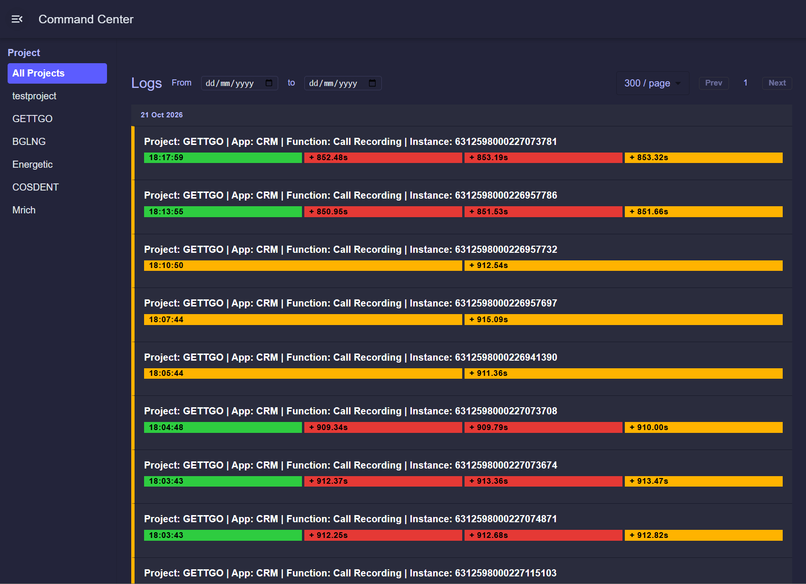

# Command Center

Command Center is a web-based operational log viewer for applications and
functions running in Zoho Catalyst. It gives development and operations teams a
single place to browse execution logs, narrow them by project, app, or
function, and inspect the timeline of a particular execution instance.

The repository contains two deployable parts:

- A React single-page application built with Create React App and Material UI.
- A Zoho Catalyst Node.js/Express function that reads and writes log data in
  Catalyst DataStore and exposes the API consumed by the frontend.

## Why this project exists

Distributed applications often produce logs across multiple projects,
applications, and serverless functions. Searching those logs independently
makes it difficult to answer questions such as:

- Which function produced an error?
- What happened during one execution instance?
- Did a pending operation later succeed or fail?
- What logs were created during a particular time range?

Command Center addresses this by normalizing project, app, and function names
through a lookup table and presenting related log records as execution cards.
Records are grouped by `Project + App + Instance`, ordered chronologically
inside each group, and displayed with status-oriented visual cues.

## Main features

- **Hierarchical navigation**: choose a project, then an app, then a function
  from the left-hand drawers. Each selection filters the log feed.
- **Log timeline cards**: records belonging to one execution instance are
  grouped together and shown in chronological order.
- **Status visualization**: `SUCCESS`, `PENDING`, and `ERROR` statuses have
  distinct colors. Other statuses are presented as a generic logging state.
- **Log details**: open a card to inspect the individual records, including
  status, creation time, instance, and text.
- **Date filtering**: filter logs by an inclusive start and end date.
- **Pagination**: browse 300 records per page or use the larger 1,000-record
  view. The 1,000-record view combines five API requests of 200 records.
- **Responsive workspace layout**: show or hide the filter drawers to give
  the log feed more room.
- **Lookup normalization**: the UI displays human-readable values while
  stored log rows reference lookup IDs.
- **Log ingestion API**: other services can submit logs through the Catalyst
  function's `POST /log` endpoint.

## Architecture

```text
Browser
  |
  | React + Material UI
  | GET /server/command_center_function/lookup
  | GET /server/command_center_function/all
  |
  v
Zoho Catalyst command_center_function
  |
  | Catalyst SDK: ZCQL and DataStore
  |
  +--> Lookups table
  +--> Logs table
```

### Frontend

The frontend is in [`command-center/`](./command-center). The application
starts at [`src/App.js`](./command-center/src/App.js), which coordinates the
app bar, filter drawers, and main log area.

Important UI modules include:

- [`CustomAppBar.js`](./command-center/src/components/CustomAppBar.js):
  toggles the filter drawers.
- [`CustomDrawer.js`](./command-center/src/components/CustomDrawer.js):
  loads lookup values and renders the Project, App, and Function filters.
- [`MainContent.js`](./command-center/src/components/MainContent.js):
  manages the drawer layout and passes filters to the log table.
- [`LogTable.js`](./command-center/src/components/LogsTable/LogTable.js):
  fetches, paginates, groups, and renders logs.
- [`LogCard.js`](./command-center/src/components/LogsTable/LogCard.js) and
  [`LogCardPopup.js`](./command-center/src/components/LogsTable/LogCardPopup.js):
  render grouped execution summaries and detailed records.

The frontend calls the Catalyst function using the deployment-relative
`/server/command_center_function/...` paths. No API URL is hard-coded, so the
same build can be served by the Catalyst client integration.

### Backend

The backend is in
[`functions/command_center_function/`](./functions/command_center_function).
It is an Express application initialized with the Zoho Catalyst Node SDK. The
function is registered in [`catalyst.json`](./catalyst.json) and is mounted by
Catalyst under the `command_center_function` name.

The backend currently provides:

| Method | Path | Purpose |
| --- | --- | --- |
| `GET` | `/all` | Return a paginated, sorted, optionally filtered set of logs |
| `POST` | `/log` | Create a log record and its required lookup records |
| `GET` | `/lookup` | Return all project, app, and function lookup rows |

## Data model

The function expects two Catalyst DataStore tables.

### `Lookups`

Lookup rows provide display values and hierarchical relationships:

| Field | Meaning |
| --- | --- |
| `ROWID` | Catalyst row identifier |
| `Type` | `Project`, `App`, or `Function` |
| `Value` | Human-readable name |
| `LID` | Parent lookup row ID; apps point to projects and functions point to apps |

When a log is created, the backend finds or creates the Project, App, and
Function lookup rows and stores their row IDs in the log record.

### `Logs`

The log table is expected to contain at least:

| Field | Meaning |
| --- | --- |
| `ROWID` | Catalyst row identifier |
| `Project` | Project lookup row ID |
| `App` | App lookup row ID |
| `Function` | Function lookup row ID |
| `Instance` | Execution or correlation identifier |
| `Status` | Log state such as `SUCCESS`, `PENDING`, or `ERROR` |
| `Text` | Free-form log message |
| `CREATEDTIME` | Catalyst-created timestamp used for sorting and date filtering |

If `Instance` is omitted when calling `POST /log`, the function generates a
unique value from the current epoch and a random suffix. If `Status` is
omitted, it defaults to `LOG`.

## API reference

### `GET /all`

Returns logs in descending creation-time order by default.

Supported query parameters:

| Parameter | Default | Description |
| --- | --- | --- |
| `page` | `1` | One-based page number |
| `perPage` | `100` | Number of rows per request |
| `sort` | `CREATEDTIME` | Sort column |
| `order` | `desc` | `asc` or `desc` |
| `type` | empty | Lookup level used for filtering: `Project`, `App`, or `Function` |
| `LID` | empty | Lookup row ID used with `type` |
| `startDate` | empty | Lower `CREATEDTIME` bound |
| `endDate` | empty | Upper `CREATEDTIME` bound |

Successful responses have this shape:

```json
{
  "status": "success",
  "data": {
    "Logs": [],
    "hasMore": false
  }
}
```

### `POST /log`

Creates a log record. A typical request body is:

```json
{
  "Project": "Billing",
  "App": "Invoice API",
  "Function": "createInvoice",
  "Instance": "invoice-2026-0001",
  "Status": "SUCCESS",
  "Text": "Invoice created"
}
```

`Project`, `App`, and `Function` are human-readable values on input. The
function converts them to lookup IDs before inserting the log row.

### `GET /lookup`

Returns all rows from `Lookups`. The frontend uses the `LID` relationships to
populate the dependent App and Function drawers.

## Repository layout

```text
.
├── catalyst.json                         # Catalyst client/function mapping
├── .catalystrc                           # Active Catalyst project/environment
├── package.json                           # Root workspace and shared dependencies
├── command-center/
│   ├── package.json                       # React scripts and frontend dependencies
│   ├── public/
│   └── src/
│       ├── App.js
│       └── components/
└── functions/
    └── command_center_function/
        ├── index.js                      # Express routes and Catalyst access
        ├── package.json
        └── catalyst-config.json
```

`node_modules` and generated build output are intentionally not part of the
source layout described here.

## Prerequisites

- Node.js 14 or newer for the Catalyst function. A current LTS release is
  recommended for local frontend development.
- npm.
- A Zoho Catalyst account and project if connecting to the hosted DataStore or
  deploying the application.
- Catalyst CLI with the React plugin when using Catalyst deployment commands.

## Local development

Install dependencies from the repository root:

```bash
npm install
```

Start the React development server:

```bash
cd command-center
npm start
```

The frontend is served at `http://localhost:3000`. Its API paths are
deployment-relative (`/server/command_center_function/...`), so local UI work
requires a Catalyst-compatible proxy or a deployed function for live data.
Without that proxy/function, the page can load but API-backed lookups and logs
will not be available.

To run the function locally:

```bash
cd functions/command_center_function
npm start
```

The function relies on Catalyst request initialization and DataStore access,
so local execution should be treated as a development aid; use the Catalyst
runtime or its supported local emulation when testing authenticated
DataStore/ZCQL behavior.

## Testing and production build

Run the frontend test suite:

```bash
cd command-center
npm test
```

Create an optimized production frontend bundle:

```bash
cd command-center
npm run build
```

The current test file is still the Create React App smoke-test placeholder and
should be expanded with coverage for lookup filtering, date filtering,
pagination, grouping, and API error states as the application evolves.

## Catalyst configuration and deployment

The root [`catalyst.json`](./catalyst.json) connects:

- `command-center/` to the Catalyst React client plugin.
- `functions/` to the `command_center_function` target.

The checked-in [`.catalystrc`](./.catalystrc) selects the `CommandCenter`
project and its `Development` environment. Verify the active Catalyst project
and environment before deploying, especially when working with production
data.

Before deployment:

1. Create or verify the `Logs` and `Lookups` DataStore tables.
2. Confirm the required columns and lookup relationships described above.
3. Authenticate the Catalyst CLI and select the intended environment.
4. Build and test the frontend.
5. Deploy using the Catalyst CLI workflow appropriate for your account and
   project.
6. Verify `/lookup`, `/all`, and `/log` in the deployed environment before
   opening the UI to users.

The repository does not define a root deployment script, so deployment
commands should come from the Catalyst CLI version and project workflow used
by the team rather than being guessed here.

## Operational considerations

- Keep the `Logs` table indexed and retain only the history needed for the
  operational use case; the UI can request hundreds of rows per page.
- Treat `Instance` as the correlation key for one execution. Producers should
  reuse the same value for all events in that execution.
- Use consistent status names. The UI has explicit colors for `SUCCESS`,
  `PENDING`, and `ERROR`; unknown values fall back to the generic logging
  style.
- Protect the deployed Catalyst endpoints with the authentication and access
  controls appropriate for the project.
- Do not commit Catalyst credentials or other secrets. The current frontend
  does not require a secret because it calls deployment-relative endpoints.

## Known limitations and next improvements

- The backend builds ZCQL filter strings from request values. Production
  hardening should validate allowed sort/type values and safely handle all
  user-controlled inputs before exposing the endpoint broadly.
- The frontend retries a failed log request after a short delay, but there is
  no visible error state for the user.
- Lookup data is loaded once per component and is not refreshed automatically.
- The existing automated test is a starter smoke test and does not yet model
  the current Command Center UI.
- There is no repository-level lint, type-check, or deployment script.

## License

No license file is currently included in the repository. Add the project’s
chosen license before distributing the code outside its intended organization.
